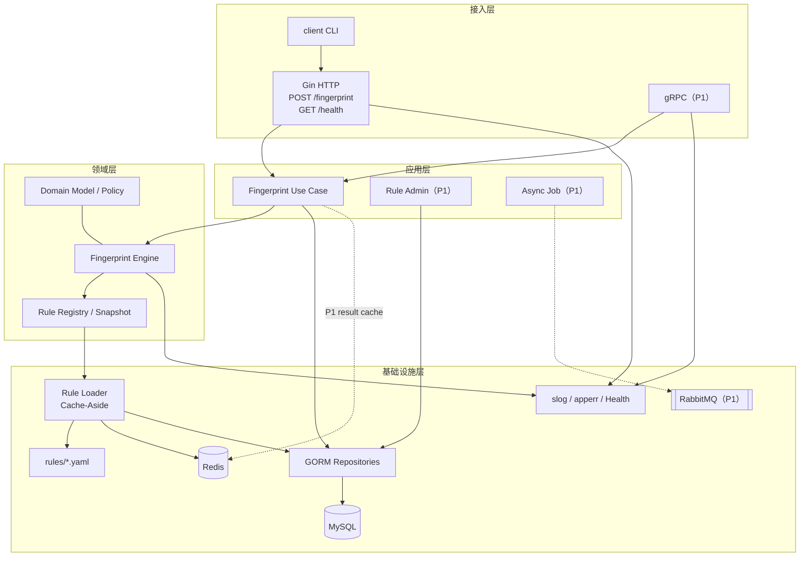
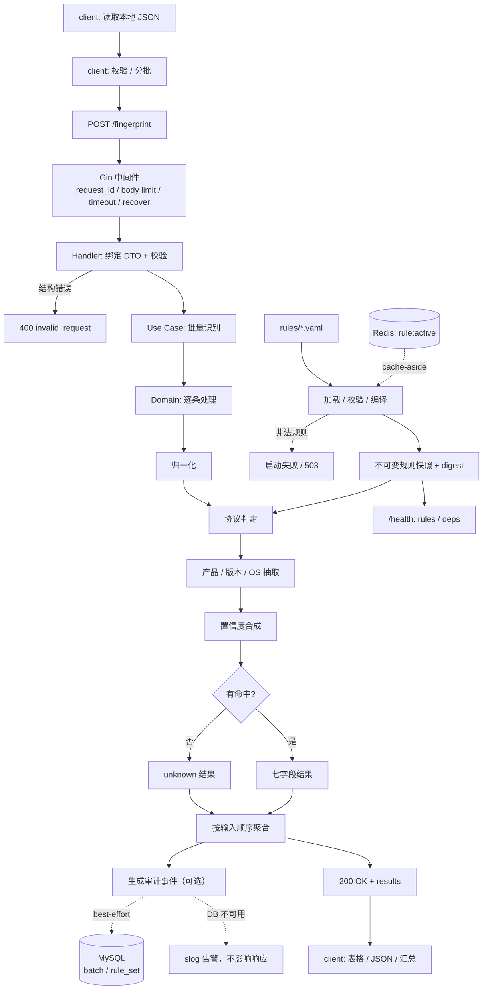
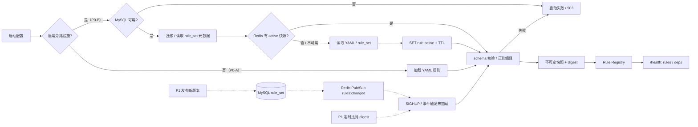
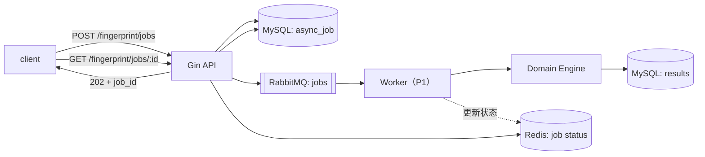
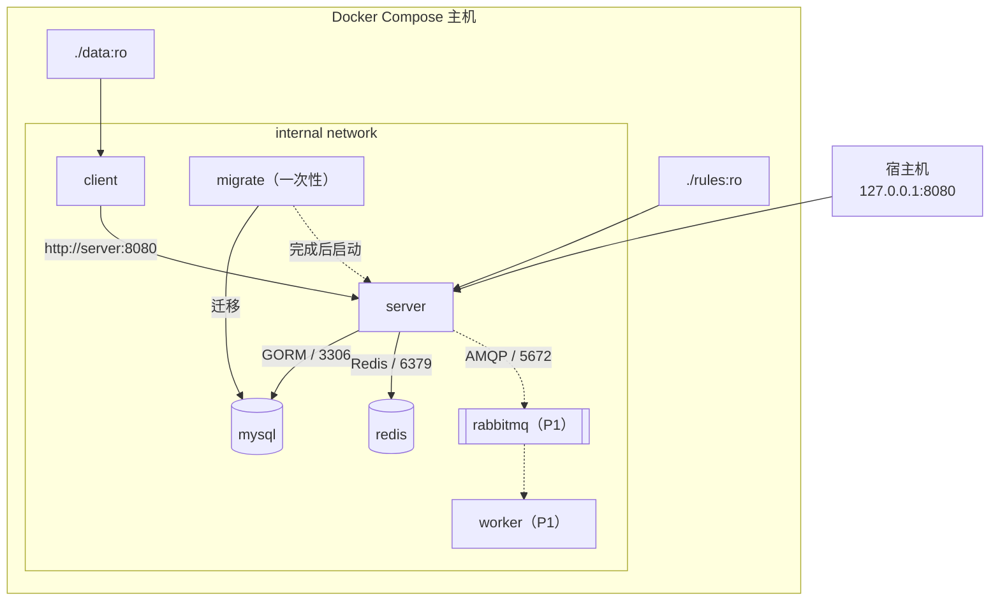

# Banner 指纹识别系统 架构设计

| 项目 | 内容 |
|---|---|
| 文档版本 | v0.2（草案） |
| 编制日期 | 2026-10-23 |
| 文档状态 | 待评审 |
| 输入依据 | `docs/REQUIREMENTS.md` v0.1、指定技术栈 |
| 设计范围 | P0 主链路 + P1 可选扩展；只设计，不写代码 |
| 技术栈 | Go、Gin、GORM、MySQL、Redis、测试库、slog、错误库；可选 RabbitMQ、gRPC；依赖服务跑在本机 Docker |

### 变更记录

| 版本 | 日期 | 变更 |
|---|---|---|
| v0.1 | 2026-10-23 | 初版：Gin/GORM/MySQL/slog/eris；RabbitMQ/gRPC 为 P1 |
| v0.2 | 2026-10-23 | 加入 Redis：规则快照缓存、限流/幂等/任务状态（P1）；明确 Redis 不进识别热路径 |

> 设计结论先行：
>
> 1. **P0 识别主链路保持内存计算**：Client → Gin → Application → Domain（规则快照）→ 200 响应。
> 2. **MySQL/GORM 与 Redis 都放在旁路**：MySQL 承载规则元数据、批次审计、异步任务；Redis 承载规则快照缓存、限流/幂等/任务状态（P1）。识别热路径不查 MySQL、不查 Redis、不走 MQ/gRPC。
> 3. **RabbitMQ/gRPC 仍定为 P1 可选**：P0 不引入，避免改变 `POST /fingerprint` 同步契约与一键启动复杂度。
> 4. **两套部署 profile**：`P0-B`（MySQL + Redis 旁路，推荐用于本技术栈）/ `P0-A`（严格遵循需求文档的无 DB、无缓存最小闭环）。推荐 P0-B，但需要把需求基线更新到 v0.2。

---

## 1. 架构目标、原则与范围

### 1.1 架构目标

| 编号 | 目标 |
|---|---|
| A-01 | 满足需求文档 P0 的 12 项功能与验收口径 |
| A-02 | Gin 做接入、领域层做纯识别、GORM/MySQL 与 Redis 做旁路，职责不串层 |
| A-03 | 识别热路径无 MySQL、无 Redis、无 MQ、无 RPC，保证延迟与可用性 |
| A-04 | 规则与代码解耦，支持版本、校验、摘要、缓存与原子切换 |
| A-05 | 为 P1 的异步批量、gRPC 接入、规则管理、结果缓存预留端口，不提前复杂化 P0 |
| A-06 | 生产级运行：健康检查、结构化日志、错误码、权限收紧、可测试 |
| A-07 | 本机 Docker 可复现：MySQL/Redis/RabbitMQ 全部容器化，开发、测试、演示共用一套编排 |

### 1.2 架构原则

1. **热路径纯内存**：单条识别只做归一化、匹配、抽取、置信度计算；P0 不访问 MySQL、Redis、RabbitMQ、gRPC。
2. **Redis 不是事实源**：Redis 只做缓存/协调；缓存未命中或 Redis 故障时回退 YAML/MySQL，不得影响识别正确性。
3. **MySQL 不是热路径**：规则启动时加载为不可变快照；审计与任务写入是旁路，失败只降级。
4. **依赖倒置**：接入层 → 应用层 → 领域层；领域层定义端口，基础设施层实现端口，领域层不依赖 Gin/GORM/Redis SDK。
5. **失败隔离**：单条异常降级 unknown；审计/缓存失败只告警；MQ/gRPC 不可用不影响 P0 同步识别。
6. **规则不可变快照**：启动时校验、编译成不可变快照；热加载用原子替换，在途请求继续使用旧快照。
7. **缓存键带版本**：规则缓存与结果缓存都以 `rule_digest` 为版本维度；规则变化后旧键自然过期，不依赖删除操作。
8. **边界校验**：HTTP/gRPC/MQ 入口统一做体积、条数、类型、超时限制；领域层假设输入已限长。
9. **错误分层**：领域错误码 → 应用错误 → 传输层映射；对外不泄露堆栈和 SQL。
10. **可观测默认**：每个请求有 request_id；日志结构化；健康检查暴露规则摘要与依赖状态；不记录 banner 原文。
11. **渐进式**：P0 只做同步闭环；P1 才引入 RabbitMQ/gRPC/结果缓存/限流；P2 才考虑指标、水平扩展。
12. **本机 Docker 优先**：依赖服务不要求本机安装；Compose 与 testcontainers 都使用本机 Docker。

### 1.3 技术栈定位

| 技术 | 角色 | 优先级 | 设计约束 |
|---|---|---|---|
| Go | 服务端与客户端语言 | P0 | 单二进制、静态编译、context 贯穿 |
| Gin | HTTP 接入层 | P0 | 只做路由/中间件/绑定/校验/错误映射，不写业务 |
| GORM | 持久化适配器 | P0 | 只在 infrastructure 层；仓储接口；禁止生产 AutoMigrate |
| MySQL 8.0 | 规则元数据、批次审计、异步任务 | P0（旁路） | 不进识别热路径；utf8mb4；UTC；不存 banner 原文 |
| Redis 7 | 规则快照缓存、限流/幂等/任务状态 | P0（缓存）/P1（协调） | 不进识别热路径；不是事实源；不存 banner 原文 |
| slog | 结构化日志 | P0 | JSON Handler；context 注入 request_id；脱敏 |
| eris（错误库） | 错误包装与堆栈 | P0 | 领域错误码 + `errors.Is/As`；对外只暴露公开消息 |
| testify | 断言/测试组织 | P0 | 领域表驱动、传输层测试 |
| go-sqlmock | 仓储单元测试 | P0 | 不替代真实 MySQL 集成测试 |
| testcontainers-go | MySQL/Redis/RabbitMQ 集成测试 | P1 | 使用本机 Docker；不依赖外部测试环境 |
| RabbitMQ | 异步任务/事件 | P1 | 可选；P0 不引入；outbox + 幂等消费 |
| gRPC | 内部/高性能接入 | P1 | 可选；与 REST 共享应用层；proto 契约 |
| YAML 规则 | 识别规则源 | P0 | 只读挂载；启动校验；不写进 Go 代码 |
| golang-migrate | 数据库迁移 | P0 | 版本化 SQL；一次性 migrate 服务 |

> 说明：本文中的“测试库”按测试框架与测试依赖理解（testify、httptest、sqlmock、testcontainers）。如果指的是“测试数据库”，则用 testcontainers 在本机 Docker 启动独立 MySQL/Redis 实例，不共享开发库。
>
> “slog 错误库”按 `slog`（日志）+ `eris`（错误包装）理解；如果团队已有统一错误库，可替换 `eris`，不影响分层与错误码设计。

### 1.4 与需求文档的偏差

需求文档 v0.1 的 P0 明确“无外部依赖、无数据库、两服务”。本技术栈强制引入 MySQL/Redis/GORM，属于基线变更。处理方式如下：

| 需求文档条目 | 本设计 | 影响 | 处理建议 |
|---|---|---|---|
| C-04 / NFR-M-07：无状态、不依赖数据库 | MySQL/Redis 作为旁路；识别热路径不查库、不查缓存 | 部署多 MySQL、Redis、migrate 服务 | 需求基线升 v0.2；或选 P0-A profile |
| C-03：第三方依赖最少 | 引入 Gin/GORM/Redis SDK/eris/testify 等 | 供应链与构建体积增加 | 锁定版本、最小依赖集、定期扫描 |
| C-11：两个服务 | P0-B 增加 mysql、redis、migrate；P1 可选 rabbitmq、worker | 一键启动编排更复杂 | healthcheck + 迁移一次性任务 + Redis 可降级 |
| F-P0-11：规则外置 YAML | YAML 是 P0 规则源；Redis 只缓存快照；MySQL 只存元数据/摘要 | 规则版本可审计，但不改变 YAML 源 | P1 再支持 DB 发布与跨实例通知 |
| C-13：仅 server 8080 回环发布 | MySQL/Redis/MQ 均不发布宿主端口 | 无额外暴露面 | 保持 internal network |

**结论**：推荐 `P0-B`（MySQL + Redis 旁路）作为本项目架构；如果必须严格满足需求文档 v0.1，则选 `P0-A`（不启 MySQL/Redis，规则只走 YAML），两者共用同一套领域层与接口。

---

## 2. 模块职责

### 2.1 分层视图



> 图是调用/数据流视图；依赖方向严格为 L1 → L2 → L3，L4 实现 L3 定义的端口。领域层不 import Gin、GORM、Redis SDK、RabbitMQ。

### 2.2 模块清单

| 模块 | 层 | 职责 | 明确不负责 | 优先级 |
|---|---|---|---|---|
| `cmd/server` | 入口 | 启动流程、配置加载、依赖装配、信号处理、优雅停机、健康状态初始化 | 业务识别、HTTP 细节 | P0 |
| `cmd/client` | 入口 | CLI 参数、读 JSON、调用 server、表格/JSON 渲染、退出码 | 识别规则、数据库/缓存 | P0 |
| `internal/transport/http` | 接入 | Gin 路由、中间件、DTO 绑定/校验、限额、错误映射 | 领域规则、SQL、缓存实现 | P0 |
| `internal/transport/grpc` | 接入 | proto 服务、拦截器、DTO 映射、错误映射 | 领域规则、SQL | P1 |
| `internal/application/fingerprint` | 应用 | 批量编排、并发控制、顺序回填、限额、审计事件、可选结果缓存（P1） | 协议匹配细节、SQL、Redis 命令 | P0 |
| `internal/application/ruleadmin` | 应用 | 规则集发布、激活、回滚、版本查询 | 规则匹配执行 | P1 |
| `internal/application/job` | 应用 | 异步任务创建/查询、MQ 发布、状态机 | 识别执行细节 | P1 |
| `internal/domain/engine` | 领域 | 归一化、协议判定、产品/版本/OS 抽取、置信度、unknown 兜底 | HTTP、DB、缓存、MQ | P0 |
| `internal/domain/rules` | 领域 | 规则模型、schema 校验、编译、优先级、digest、不可变快照 | 文件/DB/Redis 读取 | P0 |
| `internal/infra/rules` | 基础设施 | YAML/MySQL 读取、Redis cache-aside、热加载触发 | 匹配算法 | P0/P1 |
| `internal/infra/cache` | 基础设施 | Redis 适配：规则快照缓存、结果缓存、限流、幂等、任务状态、Pub/Sub | 领域规则、SQL | P0/P1 |
| `internal/infra/persistence` | 基础设施 | GORM 仓储、迁移、事务、批量写入、outbox | HTTP、领域决策 | P0/P1 |
| `internal/infra/messaging` | 基础设施 | RabbitMQ 发布/消费、confirm、DLQ、幂等 | 领域规则 | P1 |
| `internal/platform/config` | 平台 | env/YAML 配置、校验、profile、Redis/MySQL/MQ 连接参数 | 业务 | P0 |
| `internal/platform/apperr` | 平台 | 错误码、包装、HTTP/gRPC 映射、脱敏 | 日志输出 | P0 |
| `internal/platform/observability` | 平台 | slog、request_id、访问日志、健康聚合、脱敏 | 业务 | P0 |
| `internal/platform/idclock` | 平台 | ID/时间抽象，测试可控 | 业务 | P0 |

### 2.3 关键端口（依赖倒置）

| 端口 | 定义方 | 实现方 | 用途 |
|---|---|---|---|
| `RuleProvider` | 领域/应用 | `infra/rules` | 提供当前不可变规则快照 |
| `RuleRepository` | 应用 | `infra/persistence` | 规则集元数据、版本、激活状态 |
| `RuleCache` | 应用/基础设施 | `infra/cache` | 规则快照缓存、版本/digest 读取 |
| `AuditSink` | 应用 | `infra/persistence` / `infra/messaging` | 批次审计、outbox 事件 |
| `ResultCache` | 应用 | `infra/cache` | P1 识别结果缓存（默认关闭） |
| `RateLimiter` | 接入/应用 | `infra/cache` | P1 限流（公开暴露时） |
| `IdempotencyStore` | 应用 | `infra/cache` + `infra/persistence` | P1 异步任务幂等；MySQL 唯一键为事实源 |
| `JobStatusCache` | 应用 | `infra/cache` | P1 任务状态查询加速；MySQL 回源 |
| `JobQueue` | 应用 | `infra/messaging` | 异步任务发布（P1） |
| `RuleChangeNotifier` | 应用 | `infra/cache` | P1 Redis Pub/Sub 规则变更通知 |
| `Clock` / `IDGenerator` | 应用/领域 | `platform/idclock` | 时间、request_id/job_id |
| `HealthProbe` | 平台 | 各基础设施适配器 | MySQL/Redis/MQ/规则状态聚合 |

---

## 3. 系统流转图

### 3.1 P0 同步识别主流程



**流程说明**：

1. client 读取本地 JSON，做必填字段与条数初筛；P0 一批发送，P1 可按 500 条分片。
2. Gin 中间件生成/透传 request_id，限制请求体、设置超时、兜底 recover，并记录访问日志。
3. Handler 只做 DTO 绑定与结构校验；结构错误直接 400，不进入识别。
4. 应用层按输入顺序处理；内部用有界 worker pool 并发，结果按索引回填，保证顺序。
5. 领域引擎逐条执行：归一化 → 协议判定 → 产品/版本/OS 抽取 → 置信度 → unknown 兜底。
6. 应用层聚合结果，生成审计事件；审计是旁路，失败只记日志，不影响 200 响应。
7. **Redis 不在 P0 请求路径上**：它只参与启动时的规则快照缓存与健康检查；P1 才可能用于结果缓存/限流。
8. client 按表格展示七字段，并给出总数/unknown 数汇总；unknown 不作为错误。

### 3.2 规则加载、Redis cache-aside 与健康检查流程



**关键规则**：

- P0 以 YAML 为规则源；MySQL 只记录 `rule_set` 的版本、摘要、来源和激活状态；Redis 只缓存 active 快照（原始 YAML + 版本 + digest），不缓存编译后的正则。
- 启动与运行时策略分开：P0-B 启动时 MySQL 不可用则 fail fast；运行中 MySQL 断连则识别继续、审计降级、`/health` 标 degraded。Redis 从启动到运行都可降级，缓存未命中回源。
- 校验失败一律 fail fast：非法正则、重复规则 ID、缺失捕获组、confidence 越界、schema 版本不兼容。
- 热加载（P1）先编译新快照，成功后再原子替换；失败保留旧快照并告警。
- Redis Pub/Sub 只做“尽快通知”，不保证送达；各实例定时比对 digest 作为兜底。
- `/health` 返回规则数量、digest、版本、MySQL/Redis 状态；规则未加载或停机中返回 503。

### 3.3 P1 异步批量流程（RabbitMQ + Redis 状态缓存，可选）



> 这是 P1 可选扩展，**不改变 P0 的 `POST /fingerprint` 同步契约**。P0 不部署 RabbitMQ/worker，也不暴露 `/fingerprint/jobs`。任务状态以 MySQL 为事实源，Redis 只是查询加速；Redis 丢失时回源 MySQL。

### 3.4 部署视图



---

## 4. 模块输入输出

> 下列类型名为概念名，用于界定边界，不代表最终代码签名。

### 4.1 入口与接入层

| 模块 | 输入 | 输出 | 备注 |
|---|---|---|---|
| `cmd/server` | 环境变量/配置文件、OS 信号 | 进程生命周期、依赖装配、就绪状态、退出码 | 只做装配与生命周期，不写业务 |
| HTTP Router / Middleware | `http.Request`、配置、当前规则快照摘要 | `http.Response`、带 request_id 的 context、访问日志 | 只做横切能力；不写业务 |
| Fingerprint Handler | JSON DTO（items、ip、port、banner）、请求 context | `BatchResult` 或 `apperr`；HTTP 200/400/413/500/503 | 结构错误 400；unknown 仍 200 |
| Health Handler | 就绪状态、规则摘要、MySQL/Redis/MQ 状态 | JSON + 200/503 | 业务级健康，不是端口存活 |
| gRPC Server（P1） | `FingerprintRequest`、metadata/deadline | `FingerprintResponse` 或 gRPC status | 与应用层共享用例；拦截器做 request_id/日志/recover |
| client CLI | 命令行参数、环境变量、本地 JSON 文件 | HTTP 请求；stdout 表格/JSON；stderr 日志；退出码 | 不内嵌规则 |

### 4.2 应用层

| 模块 | 输入 | 输出 | 备注 |
|---|---|---|---|
| Fingerprint Use Case | `BatchCommand`（items、request_id、限额）、规则快照 | `BatchResult`（有序结果、unknown 数、耗时）、`AuditEvent`、`apperr` | 识别失败不是 error；P1 可选结果缓存 |
| Rule Admin（P1） | `PublishRuleSetCommand`、操作人、版本说明 | `RuleSetVersion`、审计事件、`apperr` | 不直接执行匹配 |
| Async Job（P1） | `CreateJobCommand`、输入引用、幂等键 | `JobID`、`JobStatus`、MQ 消息、`apperr` | 状态机：pending/running/succeeded/failed |
| Audit Dispatcher | `AuditEvent` | 批次摘要/outbox 记录；失败告警 | best-effort，不阻塞响应 |

### 4.3 领域层

| 模块 | 输入 | 输出 | 备注 |
|---|---|---|---|
| Normalizer | 原始 banner 字节、最大长度 | `NormalizedBanner`（文本视图、latin-1 字节视图、截断/二进制标记） | 数据异常不返回 error，打标记 |
| Protocol Classifier | `NormalizedBanner`、port | `ProtocolMatch`（protocol、confidence、rule_id、evidence） | 端口只加权；无命中返回 unknown |
| Product Extractor | `NormalizedBanner`、protocol | `ProductMatch`（product、version、confidence、rule_id） | 版本不完整则留空 |
| OS Extractor | `NormalizedBanner`、product/protocol | `OSHint` | 只依据 banner 证据 |
| Confidence Calculator | 证据列表（签名、产品、版本、端口一致性） | `float64` | 确定性、可解释、非概率校准 |
| Result Assembler | 各阶段 match 结果 | `Result` 七字段 | 无命中走 unknown |
| Rule Validator / Compiler | 原始规则文档 | `CompiledRuleSet` + digest 或 `ValidationError` | 纯函数；不读文件/DB/Redis |
| Rule Registry | 编译后的规则集 | `Snapshot()`、`Match()`；不可变 | 原子替换；在途请求持旧快照 |

> 领域层不感知缓存：缓存是 `infra/rules` 的装饰器，命中与否不改变领域输入输出语义。

### 4.4 基础设施层

| 模块 | 输入 | 输出 | 备注 |
|---|---|---|---|
| YAML Rule Loader | 规则目录、文件变更事件 | 原始规则文档、加载错误 | 只读挂载；P1 支持 SIGHUP |
| Redis Cache Adapter | key、value、TTL、操作类型（GET/SET/PUBLISH/INCR/SETNX） | 命中/未命中、值、计数、错误 | 规则快照、结果缓存、限流、幂等、任务状态 |
| Rule Metadata Repository（GORM） | `RuleSetRecord`、版本/激活请求 | DB 行、当前激活版本、错误 | 只存元数据/摘要，不存匹配逻辑 |
| Audit Repository（GORM） | `RecognitionBatch`、可选的 item 记录 | 插入结果、错误 | P0 只写批次摘要；P1 写明细 |
| DB Manager / Migrations | DSN、迁移配置 | `*gorm.DB`、ping 结果、迁移状态 | 连接池、超时、UTC |
| RabbitMQ Publisher / Consumer（P1） | 事件/任务、队列配置 | 发布确认、消费结果、ack/nack、错误 | 持久化队列、DLQ、幂等 |
| Config | 环境变量、配置文件 | `Config`、校验错误 | 支持 P0-A/P0-B profile；Redis/MySQL/MQ 参数 |
| Logger / Request ID | context、字段、错误 | JSON 日志、带 request_id 的 context | 脱敏；不记录 banner |
| Error Mapper | `error`（含 `apperr`） | HTTP status/code 或 gRPC status、公开消息 | 不泄露堆栈/SQL |
| Health Aggregator | 规则状态、MySQL/Redis/MQ 探针 | 健康 JSON、200/503 | Redis/MySQL 故障是 degraded，不是 not ready |
| ID / Clock | 无 | request_id/job_id、时间 | 测试可注入固定值 |

---

## 5. 项目难点与技术栈应对

### 5.1 难点总览

| ID | 难点 | 影响 | 优先级 |
|---|---|---|---|
| D-01 | MySQL 与识别热路径的耦合 | 延迟、可用性、连接池 | P0 |
| D-02 | 规则解耦、版本化与热加载 | 评估重点、可运维性 | P0 |
| D-03 | 10k 批量性能与内存 | 超时、OOM、评估体验 | P0 |
| D-04 | unknown 兜底与 panic 隔离 | 服务崩溃、整批失败 | P0 |
| D-05 | 二进制 banner、JSON 与 MySQL 编码 | 版本识别错误、数据损坏 | P0 |
| D-06 | RabbitMQ 可靠性与双写一致性 | 消息丢失/重复、任务状态错乱 | P1 |
| D-07 | gRPC/REST 双协议一致性 | 契约漂移、错误码不一致 | P1 |
| D-08 | slog 可观测性与隐私 | 排障困难、日志泄露 | P0 |
| D-09 | GORM 工程化陷阱 | 迁移事故、N+1、连接耗尽 | P0 |
| D-10 | Compose 多服务启动与迁移 | 一键启动失败、竞态 | P0 |
| D-11 | 测试策略与真实夹具 | 回归不足、误判 | P0 |
| D-12 | 协议歧义与置信度 | SMTP/FTP 误判、分数不可信 | P0 |
| D-13 | Redis 缓存一致性、击穿与雪崩 | 旧规则/旧结果、瞬间打满回源 | P0/P1 |
| D-14 | Redis 可用性、eviction 与协调正确性 | 缓存故障放大、锁/幂等失效 | P0/P1 |

### 5.2 关键难点展开

#### D-01 MySQL 与识别热路径的耦合

**为什么难**：识别是 CPU 型、低延迟操作；MySQL 引入网络往返、连接池竞争和可用性耦合。若每条识别都写库，10k 批量会被数据库拖垮；若运行中 MySQL 故障就拒绝识别，违背“unknown 不崩、服务可用”的目标。

**技术栈应对**：

- 规则启动时加载为不可变内存快照，热路径零 SQL；GORM 只服务元数据、审计、任务。
- 审计改为批次级写入（一次 batch summary），不做逐条 insert；P1 明细走 RabbitMQ/worker。
- 审计失败只 `slog.Warn`，不改变 HTTP 200；用 `context.WithTimeout` 限制 DB 操作，避免拖慢请求。
- `/health` 区分 `ok` 与 `degraded`：规则已加载但 MySQL 不可用时返回 200 + `dependencies.mysql=down`；只有规则未加载/停机才 503。
- GORM 连接池设置上限、空闲数与生命周期，避免批量请求耗尽连接。

**验收**：启动后停掉 MySQL，10k 批仍返回 200；`/health` 显示 degraded；日志有审计失败告警；无识别错误。

#### D-02 规则解耦、版本化与热加载

**为什么难**：题目明确检查“规则与代码解耦”；引入 MySQL/Redis 后，规则到底放 YAML、DB 还是缓存、如何保证一致性、如何热加载而不丢请求，都是架构决策。

**技术栈应对**：

- YAML 作为 P0 的 GitOps 规则源；MySQL 的 `rule_set` 存版本、digest、内容快照、激活状态；Redis 缓存 active 快照，减少启动/重载回源。
- 领域层定义规则模型、校验器、编译器；Go 代码不出现产品名/版本正则。
- 启动时校验失败 fail fast；编译成不可变快照，`atomic.Pointer` 式替换；在途请求持旧快照。
- `/health` 与启动日志都输出规则数量、版本、digest；规则变更可追溯。
- P1 才支持“DB 发布新版本 → Redis Pub/Sub/SIGHUP → 重新编译 → 原子切换”；P0 仍是重启加载。
- 不使用 GORM `AutoMigrate` 管理 `rule_set`，用版本化迁移，避免 schema 漂移。

**验收**：不重编镜像新增 YAML 规则并重启后生效；非法正则启动失败并指出文件/行号；digest 随内容变化；热加载失败保留旧规则。

#### D-03 10k 批量性能与内存

**为什么难**：Gin 的 JSON 绑定会复制数据；10k 条 × 规则集正则匹配是主要 CPU；GORM 逐条审计会放大延迟；请求体上限与内存上限需要同时控制。

**技术栈应对**：

- `http.MaxBytesReader` + 自定义 decoder，先校验条数/单条长度，再进入识别；避免把超大 body 全量绑定到内存。
- 规则预编译（RE2 线性时间）；按协议前缀/端口做预筛，只跑候选协议的产品规则；unknown 早停。
- 有界 worker pool（按 `GOMAXPROCS` 或配置），结果按索引回填；用 context 取消，避免超时后继续算。
- 审计只写批次摘要；P1 明细异步批量写；不在请求路径做逐条 GORM。
- 基准测试 + pprof；对 1 KiB/16 KiB 两类 banner 分别压测；内存上限与队列长度可配置。

**验收**：10k 条在 30 秒内完成（P0 底线）；P1 目标 p95 ≤ 5s；无 OOM；超时请求可取消。

#### D-04 unknown 兜底与 panic 隔离

**为什么难**：Gin 的 `Recovery` 是请求级兜底，一旦单条规则 panic，整个批次可能 500；错误库若把堆栈带进响应，会泄露内部信息。

**技术栈应对**：

- 领域层把“认不出”建模为正常结果 `unknown`，不是 error；只有内部错误才走 `apperr`。
- 应用层逐条 `defer recover`：单条 panic → unknown + `slog.Error`（含堆栈）+ 计数；整批继续。
- Gin `Recovery` 只作为最后一道防线，返回 500 公开错误，不返回堆栈。
- `apperr` 区分公开消息与内部原因；HTTP/gRPC 映射只输出 code + 安全 message + request_id。
- 用 fuzz + 病态夹具覆盖：空、NUL、非法 UTF-8、截断、超长、正则元字符。

**验收**：病态输入全部 200/unknown 或按约定 4xx；fuzz 60 秒无 panic；单条异常不影响同批其他结果。

#### D-05 二进制 banner、JSON 与 MySQL 编码

**为什么难**：JSON 字符串只能安全承载 Unicode；MySQL 握手含任意字节；MySQL 的 utf8mb4 不能无损存原始字节；GORM 默认字符串映射会放大问题。

**技术栈应对**：

- P1 增加 `banner_b64`；内部统一转 `[]byte`，并生成 latin-1 字节视图供正则匹配；不依赖 UTF-8 解码。
- P0 对文本 JSON 做容错；非法 UTF-8 不 panic，按字节视图匹配，失败则 unknown。
- MySQL 不存 banner 原文；审计存 SHA-256 哈希 + 长度；确实需要留存时用 `VARBINARY`/受控字段，并单独评审隐私。
- Redis 同样不存 banner 原文；结果缓存 key 用 `sha256(port, banner)`，值只存协议/产品/版本/OS/置信度五个字段；`ip`/`port` 由请求回填，避免跨 IP 污染。
- `rule_set.content` 用 `LONGTEXT`/`JSON` 存 YAML 快照；文本字段统一 utf8mb4；时间统一 UTC。
- 测试夹具包含 0x00、0xFF、非法 UTF-8、MySQL 4 字节包头。

**验收**：MySQL 5.7/8.0/MariaDB 握手在文本与 base64 两种输入下都能识别；数据库/缓存无乱码；审计无原文。

#### D-06 RabbitMQ 可靠性与双写一致性（P1）

**为什么难**：MySQL 写任务、RabbitMQ 发消息是双写，任何一步失败都会造成“有任务没消息”或“有消息没任务”；消费端还可能重复投递。

**技术栈应对**：

- 采用 transactional outbox：GORM 事务内写 `async_job` + `outbox_event`；独立 publisher 轮询 outbox 发 MQ，成功标记 published。
- 持久化/quorum 队列、publisher confirm、手动 ack、失败重试 + DLQ；消费端按 job_id 幂等。
- 任务状态机只允许合法迁移；重复消息不重复执行；失败记录 error_code。
- Redis 只缓存任务状态，查询时回源 MySQL；Redis 丢失不影响任务正确性。
- P0 不启用 MQ；以上仅在 P1 profile 生效，不影响同步接口。

**验收**：消费者处理完未 ack 被杀 → 消息重投且结果不重复；outbox 断点恢复不丢事件；DLQ 可观测。

#### D-13 Redis 缓存一致性、击穿与雪崩

**为什么难**：规则快照缓存可能读到旧版本；结果缓存若不区分规则版本会返回过期识别；缓存失效瞬间大量请求回源；任意 banner 可能制造大量冷 key；热 key 会打爆单个 Redis 分片。

**技术栈应对**：

- **规则缓存**：`fp:rule:active` 只存原始 YAML + version + digest；本地编译校验；缓存值带 digest，读到 digest 不合法就回源。
- **结果缓存**：key 为 `fp:result:{rule_digest}:{sha256(port, banner)}`；规则一变 digest 变，旧键自然失效，不依赖删除；TTL 5–15 分钟 + 随机抖动。
- **防击穿**：`singleflight` 按 key 合并回源；规则加载全局只允许一个编译流程；结果缓存只对成功识别写入，unknown 不缓存或仅极短 TTL。
- **防雪崩**：TTL 加随机抖动；Redis 故障时回源 YAML/MySQL，并限制回源并发；`slog` 记录 hit/miss/回源耗时。
- **防热 key**：结果缓存 key 打散；必要时本地 LRU + Redis 两级缓存；对超热 banner 只做本地缓存。
- **隐私**：key 用哈希，不存 banner 原文；值只存五元识别结果，不含 `ip`/`port`，命中后由请求回填，避免跨 IP 污染。

**验收**：规则 digest 变更后旧结果键不再命中；并发 100 个相同冷 key 只回源一次；Redis 清空后识别仍正确；无 banner 原文落缓存。

#### D-14 Redis 可用性、eviction 与协调正确性

**为什么难**：Redis 是单点；`maxmemory` 触发 eviction 可能删掉锁/幂等键；Pub/Sub 不保证送达；如果用 Redis 锁保护关键区，网络分区会导致双写或死锁。

**技术栈应对**：

- **Redis 可降级**：P0-B 启动时 Redis 不可用不 fail fast；缓存未命中回源 YAML/MySQL；`/health` 标 degraded，识别继续。
- **eviction 策略**：`maxmemory` 128–256 MB；`maxmemory-policy volatile-lru`；所有缓存/协调键都设 TTL；规则快照可重建，允许被淘汰。
- **不把正确性押在 Redis 锁上**：规则激活/迁移等关键区用 MySQL 唯一约束或租约表；Redis `SET NX PX` 只做 best-effort 协调，不作为唯一正确性保证。
- **幂等以 MySQL 为准**：`async_job` 的幂等键唯一约束是事实源；Redis 只做快速判重，eviction/丢数据不影响最终幂等。
- **Pub/Sub 只做加速**：实例定时比对 digest 兜底；消息丢失最多延迟一次轮询周期。
- **限流策略**：内部/回环默认不启用；公开暴露时启用，明确 fail-open（保可用）或 fail-closed（保保护）策略，并记录降级日志。
- **安全**：Redis 不发布宿主端口；密码/ACL；只读网络；不开危险命令；P1 可加 TLS。

**验收**：停掉 Redis，识别与 `/health` 仍可用（degraded）；清空 Redis 后规则自动回源；模拟 eviction 后幂等仍由 MySQL 保证；Pub/Sub 丢消息后轮询能恢复。

### 5.3 其他难点与应对

| ID | 难点 | 技术栈应对 |
|---|---|---|
| D-07 | gRPC/REST 双协议一致性 | 共享应用层与领域层；transport 只做 DTO 映射；proto 用 buf lint/breaking 检查；`apperr` 统一映射 HTTP/gRPC；拦截器做 request_id、日志、recover、deadline |
| D-08 | slog 可观测性与隐私 | JSON Handler；context 注入 request_id；中间件/拦截器统一字段；`ReplaceAttr` 脱敏；不记录 banner/原始 IP；错误堆栈只进日志不进响应；P2 再接 metrics |
| D-09 | GORM 工程化陷阱 | 仓储接口隔离；全部 `WithContext`；禁止生产 AutoMigrate；golang-migrate 版本化；连接池上限/生命周期；批量 insert；避免长事务；sqlmock 单测 + testcontainers 集成 |
| D-10 | Compose 多服务启动与迁移 | MySQL healthcheck；migrate 一次性服务 + `service_completed_successfully`；Redis 并行启动、可降级；server 依赖 migrate；client 依赖 server healthy；MySQL/Redis/MQ 不发布端口；secrets 不入镜像 |
| D-11 | 测试策略与真实夹具 | 领域表驱动 + fuzz；httptest 测传输；sqlmock 测仓储；testcontainers 测 MySQL/Redis/RabbitMQ；compose e2e；真实 banner 夹具 + 负例；race 门禁 |
| D-12 | 协议歧义与置信度 | 220 必须结合 FTP 产品 token；端口只加权；规则优先级 + 负例；置信度按证据分级；规则 examples 自检；夹具回归 |

---

## 6. 数据与一致性设计

### 6.1 MySQL 表

| 表 | 用途 | 关键字段 | 优先级 | 备注 |
|---|---|---|---|---|
| `schema_migrations` | 迁移版本 | version、applied_at | P0 | golang-migrate 管理 |
| `rule_set` | 规则集元数据/版本 | id、version、digest、content、source、status、created_at、activated_at | P0 | YAML 快照；P1 支持发布/回滚 |
| `recognition_batch` | 批次审计摘要 | id、request_id、item_count、unknown_count、latency_ms、rule_digest、created_at | P0 | 不存 banner/IP 原文 |
| `recognition_item` | 明细审计 | batch_id、ip_hash、port、protocol、product、version、os_hint、confidence、rule_id、created_at | P1 | 默认关闭或采样；保留期可配 |
| `async_job` | 异步任务 | id、status、input_ref、result_ref、error_code、created_at、updated_at | P1 | 状态机；幂等键唯一 |
| `outbox_event` | 事务性发件箱 | id、aggregate_type、aggregate_id、event_type、payload、status、created_at、published_at | P1 | 解决 MySQL/MQ 双写 |

### 6.2 Redis 键设计

| Key | 类型 | TTL | 用途 | 优先级 | 说明 |
|---|---|---|---|---|---|
| `fp:rule:active` | Hash/String | 24h | active 规则快照缓存 | P0-B | 存 version/digest/原始 YAML；可重建 |
| `fp:result:{digest}:{hash}` | String | 5–15m | 识别结果缓存 | P1 | 默认关闭；hash = sha256(port, banner)；unknown 不缓存；值不含 ip/port，命中后回填 |
| `fp:ratelimit:{scope}:{id}:{window}` | Counter | 窗口长度 | 限流 | P1 | 公开暴露时启用；内部默认关闭 |
| `fp:idem:{key}` | String | 24h | 异步任务幂等快路径 | P1 | MySQL 唯一键为事实源 |
| `fp:job:{id}` | Hash | 1h | 任务状态缓存 | P1 | 查询回源 MySQL |
| `fp:rules:changed` | Pub/Sub | — | 规则变更通知 | P1 | 不保证送达；轮询兜底 |
| `fp:lock:{name}` | String NX PX | 短 TTL | best-effort 协调 | P1 | 关键正确性用 MySQL 租约/唯一键 |

### 6.3 一致性与隐私

- **不做分布式事务**：识别主链路不写库；审计/任务用本地事务 + outbox，允许最终一致。
- **规则一致性**：YAML/MySQL 是事实源；Redis 只是缓存；digest 不符就回源；Pub/Sub 丢失靠轮询。
- **结果缓存一致性**：`rule_digest` 进 key；规则变更后旧键自然失效；不依赖批量删除；缓存值不含 `ip`/`port`，命中后回填。
- **幂等**：`request_id` 唯一；异步任务 `job_id`/幂等键唯一；Redis 只做快速判重，MySQL 唯一约束兜底。
- **隐私**：MySQL/Redis 都不存 banner 原文；IP 用带密钥的 HMAC 哈希；明细审计默认关闭或采样；保留期可配置（建议批次 30 天、明细 7 天）。
- **审计/缓存失败不阻断识别**：写失败进入告警与重试队列（P1），P0 只记录日志。

---

## 7. 部署与运行设计

### 7.1 Compose 服务

| 服务 | 作用 | 依赖 | 健康检查 | 端口 | 权限/备注 |
|---|---|---|---|---|---|
| `mysql` | 规则元数据/审计 | 数据卷 | `mysqladmin ping`（带认证） | 不发布 | 最小权限应用账号；utf8mb4；UTC |
| `redis` | 规则缓存/限流/任务状态 | 无（P0 缓存可丢） | `redis-cli ping`（带认证） | 不发布 | maxmemory 128MB；volatile-lru；P0 不持久化 |
| `migrate` | 执行迁移 | mysql healthy | 退出码 0 | 无 | 一次性；失败阻断 server |
| `server` | HTTP + 识别 | migrate 完成；Redis 可降级 | `/app/server healthcheck` | `127.0.0.1:8080` | 非 root、只读根、cap 全丢 |
| `client` | 调用/展示 | server healthy | 退出码 0 | 无 | 只读挂载 `./data` |
| `rabbitmq` | 异步任务（P1） | 数据卷 | `rabbitmq-diagnostics` | 不发布 | quorum queue；最小权限 |
| `worker` | MQ 消费（P1） | mysql/mq healthy | 进程/心跳 | 无 | 与 server 同镜像不同入口 |

### 7.2 启动顺序

```text
mysql healthy → migrate 成功 → server healthy → client 执行
redis 与 mysql 并行启动；redis 不阻塞 server，只影响缓存命中率
P1: rabbitmq healthy → worker
```

- P0-A（无 MySQL/Redis）：`server healthy → client`，规则只走 YAML，审计与缓存关闭。
- P0-B（推荐）：MySQL 启动时必需（迁移/元数据）；Redis 启动时可缺失，运行中缺失只降级。
- P1：`rabbitmq healthy → worker`，worker 不阻塞 P0 主链路。

### 7.3 健康检查语义

| 状态 | HTTP | 含义 |
|---|---|---|
| 规则已加载、MySQL/Redis 正常 | 200 `ok` | 完全就绪 |
| 规则已加载、MySQL 不可用 | 200 `degraded` | 识别可用，审计降级 |
| 规则已加载、Redis 不可用 | 200 `degraded` | 识别可用，缓存/限流降级 |
| 规则未加载/停机中 | 503 `not_ready` | 不可接收识别请求 |
| P1 MQ 不可用 | 200 `degraded` | 同步识别不受影响，异步任务暂停 |

> `/health` 必须检查规则加载与核心依赖，而不是只 ping 端口；这是评分点“真实健康检测”的落点。Redis 是缓存，不应让 200 变成 503；否则缓存故障会被放大成服务不可用。

### 7.4 Redis 运行参数

| 参数 | P0 建议 | 说明 |
|---|---|---|
| `maxmemory` | 128–256 MB | 缓存与协调共用；按实例规格调整 |
| `maxmemory-policy` | `volatile-lru` | 只淘汰带 TTL 的键；所有缓存键都设 TTL |
| 持久化 | P0 关闭（`save ""`、`appendonly no`） | 缓存可重建；P1 任务状态缓存如需可开 AOF everysec |
| 连接池 | 客户端限制最大连接/超时 | 避免 Redis 故障拖垮 server |
| 认证 | 密码/ACL，走 secret | 不写进镜像/仓库 |
| 网络 | 仅 internal，不发布 6379 | 与 MySQL/MQ 一致 |

### 7.5 安全与网络

- 仅 server 8080 绑定宿主 `127.0.0.1`；MySQL 3306、Redis 6379、RabbitMQ 5672/15672 不发布。
- 所有服务在 internal network；client 用 `http://server:8080`，不经过宿主。
- server 非 root、只读根文件系统、`cap_drop: ALL`、`no-new-privileges`；规则/数据只读挂载。
- MySQL 应用账号只授予所需库表的 DML/DDL 权限；迁移账号与运行账号分离（建议）。
- Redis 使用 ACL 限制命令/键前缀；禁用 `FLUSHALL` 等危险命令（P1）。
- 凭据通过环境变量/Compose secrets 注入，不写入镜像与仓库。

---

## 8. 测试与质量策略

| 层次 | 工具 | 重点 | 门禁 |
|---|---|---|---|
| 领域单元 | testify、表驱动、fuzz | 归一化、协议判定、版本抽取、置信度、unknown | 全夹具通过；fuzz 无 panic |
| 传输层 | `httptest`、testify | 七字段、状态码、限额、request_id、错误映射 | 契约测试通过 |
| 持久化 | go-sqlmock、testcontainers-go + MySQL | 迁移、仓储、事务、outbox、连接池 | 空库迁移成功；关键查询无 N+1 |
| 缓存 | testcontainers-go + Redis | 命中/未命中、TTL、digest 失效、singleflight、降级 | Redis 停掉后识别仍正确 |
| 消息 | testcontainers-go + RabbitMQ | 发布确认、重投、幂等、DLQ | 重复消费不重复写 |
| 端到端 | Docker Compose | 一键启动、健康依赖、client 输出、权限 | P0 验收清单全过 |
| 性能 | benchmark、pprof | 10k 批、1 KiB/16 KiB banner、内存 | P0 30s 底线；P1 目标校准 |
| 契约 | JSON schema、REST/gRPC 对照 | 七字段、未知语义、错误码 | 双协议一致 |
| 安全 | `docker inspect`、日志抽查 | 非 root、只读、cap、无 banner | 安全清单通过 |

---

## 9. 架构决策记录（ADR）

| ID | 决策 | 理由 | 代价 |
|---|---|---|---|
| ADR-01 | MySQL 只做旁路，不进识别热路径 | 保证延迟与可用性；符合“unknown 不崩” | 审计非实时；需要降级语义 |
| ADR-02 | P0 规则源为 YAML，MySQL 存元数据/摘要 | 满足规则解耦与 GitOps；降低 DB 依赖 | P1 才能 DB 发布/回滚 |
| ADR-03 | Redis 只做缓存/协调，不是事实源 | 避免缓存故障影响正确性 | 需要回源、TTL、降级设计 |
| ADR-04 | RabbitMQ/gRPC 只做 P1 可选 | 避免 P0 过度设计；“可引入”不等于必须 | P1 需补 outbox/幂等/契约治理 |
| ADR-05 | GORM + golang-migrate，禁用生产 AutoMigrate | schema 可审计、可回滚 | 多一个迁移服务与流程 |
| ADR-06 | 错误库用 eris，统一 `apperr` 错误码 | 堆栈、包装、`errors.Is/As`；传输层映射清晰 | 需约束“不把堆栈返回客户端” |
| ADR-07 | 结果缓存键带 `rule_digest` | 规则变更自然失效，不依赖删除 | key 变长；旧键靠 TTL 清理 |
| ADR-08 | 关键正确性不放 Redis 锁 | 避免网络分区/eviction 导致双写 | 需要 MySQL 租约/唯一键 |
| ADR-09 | 提供 P0-A/P0-B 两套 profile | 兼顾严格需求与技术栈要求 | 配置与文档多一套分支 |

---

## 10. 待确认事项

| ID | 事项 | 影响 | 建议 | 状态 |
|---|---|---|---|---|
| AQ-01 | MySQL 是否进入 P0 | 决定 P0-A/P0-B、Compose 服务数 | 推荐 P0-B（旁路）；严格验收用 P0-A | 待定 |
| AQ-02 | RabbitMQ/gRPC 是否进入 P0 | 决定异步接口、worker、proto 治理 | 放 P1；P0 保持同步契约 | 待定 |
| AQ-03 | Redis 在 P0 的角色 | 决定是否部署 Redis、缓存哪些数据 | P0 只做规则快照缓存；结果缓存/限流放 P1 | 待定 |
| AQ-04 | Redis 部署形态 | 单机/哨兵/集群 | P0 单机 Docker；P1 再评估哨兵/集群 | 建议 |
| AQ-05 | Redis eviction/持久化 | 影响缓存命中与任务状态 | `volatile-lru` + TTL；P0 不持久化 | 建议 |
| AQ-06 | 结果缓存是否启用 | 影响性能与隐私 | 默认关闭；P1 按命中率评估 | 待定 |
| AQ-07 | 限流策略 | 影响公开暴露时的可用性 | 内部不启用；公开时明确 fail-open/closed | 待定 |
| AQ-08 | 规则源是 YAML 还是 DB | 影响热加载与评估可见性 | P0 YAML，P1 支持 DB 发布 | 待定 |
| AQ-09 | 审计范围与保留期 | 影响隐私、存储、性能 | 默认只存批次摘要；明细采样/关闭；IP 哈希 | 待定 |
| AQ-10 | 错误库选型 | 影响错误码/堆栈/依赖 | 默认 eris；可替换团队统一库 | 待定 |
| AQ-11 | 测试环境是否支持 testcontainers | 影响集成测试 | CI 需本机 Docker；否则用独立测试实例 | 待定 |
| AQ-12 | MySQL/Redis 版本 | 影响兼容性 | MySQL 8.0、Redis 7、utf8mb4、UTC | 建议 |
| AQ-13 | gRPC 是对内还是对外 | 影响鉴权、TLS、proto 兼容策略 | P1 先对内；对外需鉴权/TLS | 待定 |
| AQ-14 | 是否需要异步接口 | 影响 API 契约与部署 | P1 可选；不改变 P0 `/fingerprint` | 待定 |
| AQ-15 | 指标/追踪是否 P0 | 影响端点与依赖 | P0 只 slog + `/health`；P2 接 Prometheus/OTel | 建议 |

---

## 11. 结论

- **P0 主链路**：Gin 接入 → 应用编排 → 领域内存识别 → 200 响应；unknown 是正常结果，不是异常。
- **MySQL/GORM**：规则元数据、批次审计、P1 任务；不在热路径，故障降级不阻断识别。
- **Redis**：P0 只做规则快照缓存；P1 扩展结果缓存、限流、幂等、任务状态；不是事实源，故障可降级。
- **RabbitMQ/gRPC**：P1 可选，分别解决异步批量与高性能/内部接入；P0 不引入。
- **规则**：YAML 源 + 不可变快照 + digest；Redis 缓存原始快照，MySQL 存版本元数据；P1 再做 DB 版本发布与跨实例通知。
- **需要拍板**：AQ-01（MySQL 是否 P0）、AQ-02（MQ/gRPC 是否 P0）、AQ-03（Redis 的 P0 角色）。这三项确认后，再冻结接口与 Compose 拓扑。
